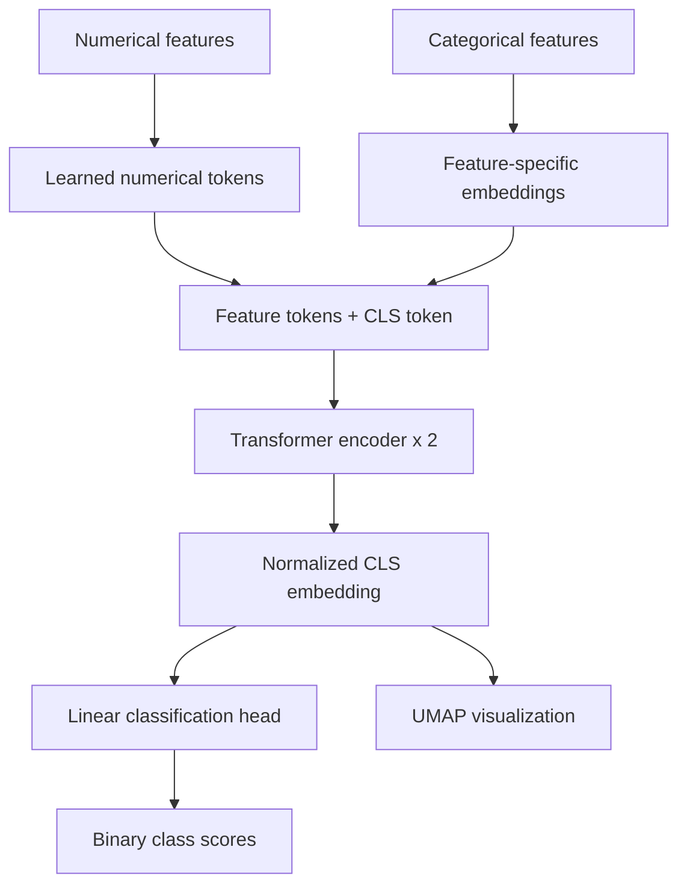

# CDC Diabetes Classification with a Tabular Transformer

A machine learning project comparing a lightweight, FT-Transformer-inspired PyTorch model with a logistic regression baseline for binary classification of diabetes and prediabetes status using CDC survey data.

## Project Overview

This project explores whether self-attention can capture interactions among demographic, lifestyle, and health-related features in structured healthcare data. It demonstrates an end-to-end workflow covering exploratory data analysis, train-only preprocessing, model training, held-out evaluation, and latent representation visualization.

## Dataset

- **Source:** [UCI CDC Diabetes Health Indicators (Dataset 891)](https://archive.ics.uci.edu/dataset/891/cdc+diabetes+health+indicators)
- **DOI:** [10.24432/C53919](https://doi.org/10.24432/C53919)
- **Samples:** 253,680
- **Features:** 21 (3 numerical and 18 categorical or ordinal)
- **Target:** `Diabetes_binary` (0 = no diabetes; 1 = prediabetes or diabetes)
- **Class distribution:** 218,334 negative samples (86.1%) and 35,346 positive samples (13.9%)

The dataset is retrieved directly using `ucimlrepo`; no local dataset download is required.

## Methodology

1. **Exploratory data analysis:** Inspect missing values, class balance, feature distributions, and correlations.
2. **Data splitting:** Use a stratified 70/15/15 train/validation/test split (177,576 / 38,052 / 38,052 samples).
3. **Preprocessing:** Fit numerical imputation and standardization, categorical encoding, and class weights on the training set only.
4. **Baseline:** Train class-balanced logistic regression with one-hot encoding for categorical features.
5. **Deep learning:** Train a simplified FT-Transformer with weighted cross-entropy, AdamW, learning-rate scheduling, gradient clipping, and validation-loss-based early stopping.
6. **Evaluation:** Compare models on the same held-out test set using accuracy, balanced accuracy, ROC-AUC, average precision, and F1 score.
7. **Representation learning:** Visualize learned 48-dimensional CLS embeddings using UMAP on a stratified subset of up to 6,000 test samples.

## Model Architecture



| Hyperparameter | Value |
|---|---:|
| Token dimension | 48 |
| Attention heads | 4 |
| Transformer encoder layers | 2 |
| Feed-forward dimension | 128 |
| Dropout | 0.15 |
| Trainable parameters | 48,402 |
| Optimizer | AdamW |
| Initial learning rate | 0.0008 |
| Early stopping patience | 3 epochs |
| Random seed | 42 |

Numerical features are transformed into feature-specific learned tokens, while categorical features use separate embedding tables. A learnable CLS token aggregates information through multi-head self-attention. The implementation uses PyTorch's Transformer encoder modules with a custom feature tokenizer and classification head; it is not an exact reproduction of the original FT-Transformer.

## Results

The recorded experiment uses the full dataset (`QUICK_RUN = False`) and a fixed classification threshold of 0.5.

| Model | Accuracy | Balanced Accuracy | ROC-AUC | Average Precision | F1 |
|---|---:|---:|---:|---:|---:|
| Logistic Regression | 0.7305 | 0.7491 | 0.8238 | 0.4047 | 0.4448 |
| Tabular Transformer | **0.7390** | **0.7506** | **0.8283** | **0.4235** | **0.4501** |

The Transformer achieved modest improvements across all reported metrics, including an absolute ROC-AUC improvement of 0.0045 and an average precision improvement of 0.0188. Training stopped at epoch 8, with the best validation loss of 0.5084.

For the positive class, the Transformer achieved a recall of 76.67% and a precision of 31.86%. These results illustrate the trade-off between identifying positive cases and generating false positives in an imbalanced classification setting. The improvements are descriptive; statistical significance has not been established.

The notebook also includes a confusion matrix, ROC and precision-recall curves, training-loss curves, and UMAP plots colored by observed class and model score.

## Getting Started

Open `CDC_Diabetes_Tabular_Transformer.ipynb` in Google Colab or Jupyter Notebook.

For a local Python environment, install the dependencies:

```bash
pip install numpy pandas matplotlib seaborn scikit-learn torch ucimlrepo umap-learn joblib ipython jupyter
```

Run the notebook from top to bottom with `QUICK_RUN = False`. The notebook automatically selects CUDA when available and otherwise uses the CPU. A GPU is recommended for faster training on the full dataset. Internet access is required to retrieve the data from UCI.

The final cell optionally exports the trained model weights, preprocessing objects, and test metrics to the runtime directory.

## Technologies

Python · PyTorch · scikit-learn · pandas · NumPy · Matplotlib · Seaborn · UMAP · Jupyter Notebook

## Limitations and Future Work

- The survey-based, cross-sectional dataset supports classification of recorded diabetes status, not prospective prediction of disease onset.
- Class imbalance results in low positive-class precision despite relatively high recall.
- Model scores have not been calibrated; they should not be interpreted as reliable absolute clinical risk estimates.
- External validation, subgroup fairness assessment, survey-aware evaluation, and comparison with additional tabular baselines such as gradient-boosted trees remain future work.
- UMAP visualizations are exploratory and do not establish clinical interpretability or model validity.

This repository is an educational machine learning project, not a clinically validated diagnostic or screening tool.

## References

- CDC Diabetes Health Indicators. UCI Machine Learning Repository. [DOI: 10.24432/C53919](https://doi.org/10.24432/C53919).
- Vaswani et al. (2017). [Attention Is All You Need](https://arxiv.org/abs/1706.03762).
- Gorishniy et al. (2021). [Revisiting Deep Learning Models for Tabular Data](https://arxiv.org/abs/2106.11959).
- McInnes, Healy, and Melville (2018). [UMAP: Uniform Manifold Approximation and Projection for Dimension Reduction](https://arxiv.org/abs/1802.03426).
